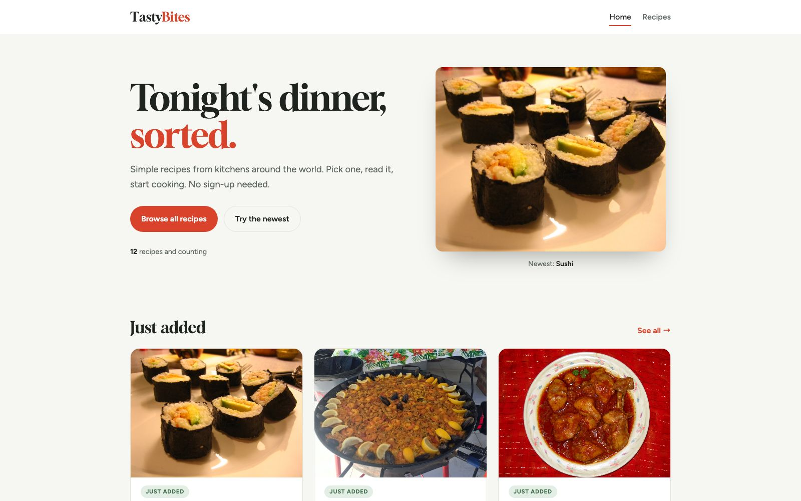
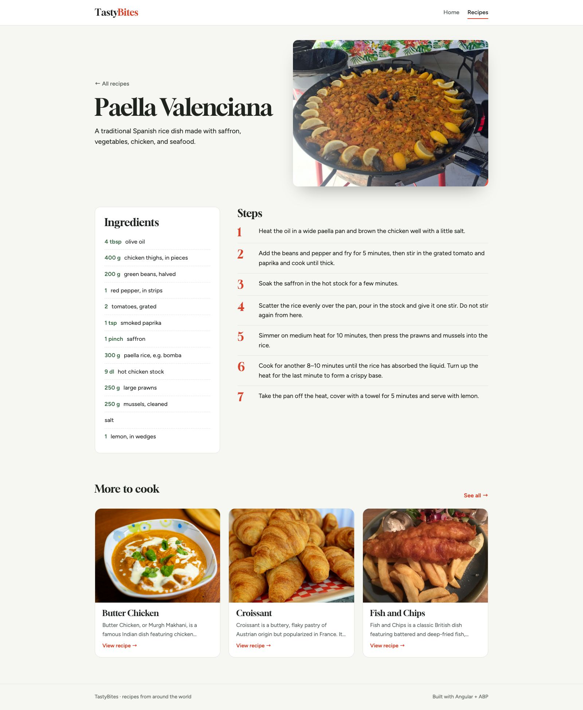
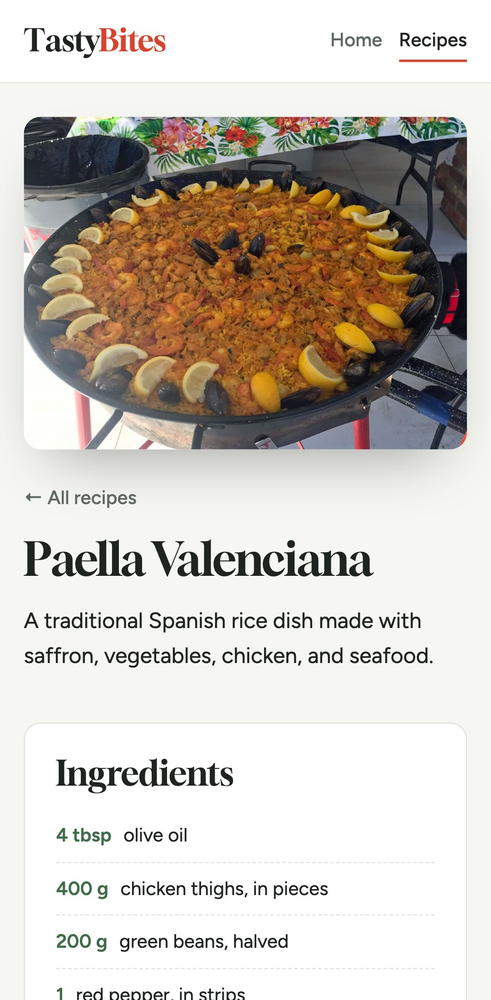
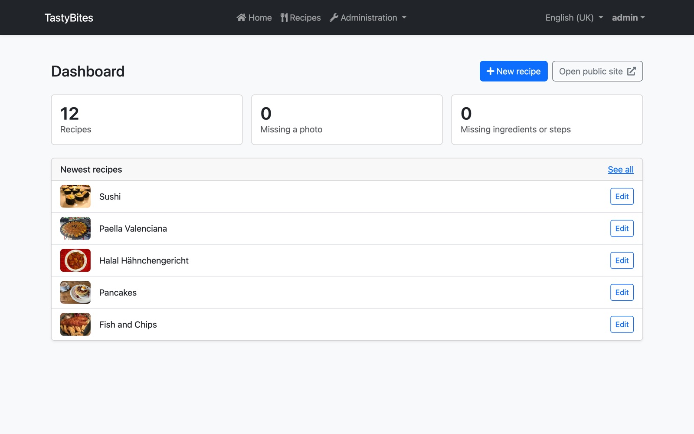
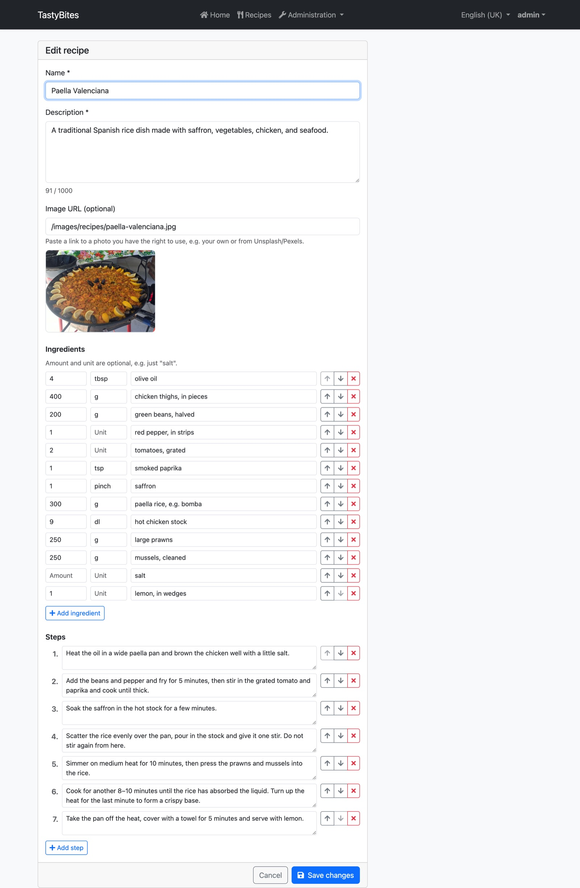
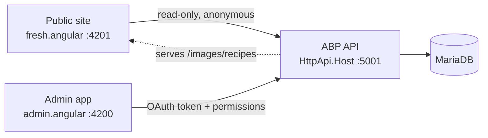

# TastyBites

A recipe website in two parts: a **public site** where visitors browse recipes without signing in, and an **admin app** where a signed-in admin creates and edits them. Both are Angular apps on top of one ASP.NET Core API built with the ABP framework.

<picture><source media="(prefers-color-scheme: dark)" srcset="docs/screenshots/public-home-dark.jpg"></picture>

| Recipe page | On a phone |
|---|---|
| <picture><source media="(prefers-color-scheme: dark)" srcset="docs/screenshots/public-recipe-dark.jpg"></picture> | <picture><source media="(prefers-color-scheme: dark)" srcset="docs/screenshots/public-recipe-mobile-dark.jpg"></picture> |

| Admin dashboard | Admin recipe form |
|---|---|
|  |  |

## Stack

| Part | Tech |
|---|---|
| Public site (`fresh.angular`, port 4201) | Angular 16, own layout and design tokens, no login |
| Admin app (`admin.angular`, port 4200) | Angular 16, ABP Angular UI, Reactive Forms, permissions |
| API (`aspnet-core`, port 5001) | ABP 7.4 on .NET 7, DDD layers, OpenIddict auth, EF Core |
| Database | MariaDB (XAMPP), port 3306 |
| Tests | xUnit + Shouldly on in-memory SQLite |

Exact versions and why: [`TastyBites/fresh.angular/README.md`](TastyBites/fresh.angular/README.md#versions).



The backend follows ABP's DDD layers: `Domain.Shared` (constants), `Domain` (entities, data seeder), `Application.Contracts` (DTOs, interfaces), `Application` (app services), `EntityFrameworkCore` (DbContext, migrations), `HttpApi.Host` (the running API) and `DbMigrator` (applies migrations and seeds data).

## What's worth looking at

- **Dynamic forms with `FormArray`** – the admin recipe form edits ingredient and step lists: add, remove, move up/down, with per-row validation that mirrors the backend limits ([`crud-recipe.component.ts`](TastyBites/admin.angular/src/app/recipes/crud-recipe/crud-recipe.component.ts)).
- **One-to-many with ordered children** – `Recipe` → `RecipeIngredient` / `RecipeStep` with `SortOrder`; update replaces both lists on purpose ([ADR 0001](docs/adr/0001-replace-ingredient-and-step-lists-on-update.md)).
- **Light list queries, full detail queries** – `DefaultWithDetailsFunc` loads ingredients and steps only when fetching one recipe; the dashboard counts run as SQL `COUNT`s.
- **Two separate apps, one API** – the public app has its own layout and uses anonymous read-only endpoints; admin endpoints are protected with ABP permission attributes.
- **Self-hosted photos** – CC0/public-domain images served from the API's `wwwroot`, stored as relative paths so they survive a domain change.
- **Idempotent data seeder** – starter recipes come from an embedded JSON file and are only inserted into an empty database; integration tests prove a second run adds nothing.
- **Secrets out of git** – DB password, token signing key and passphrase live in a gitignored `appsettings.secrets.json` (or environment variables); the API refuses to start without a signing key.

## Run it locally

Needs macOS with [XAMPP](https://www.apachefriends.org/) (MariaDB), the .NET 7 SDK and Node 18 (via nvm). `./scripts/dev.sh setup` installs the tool versions.

1. Start **MySQL Database** in XAMPP.
2. Create local secrets (sets a DB password via XAMPP's local `root` user and writes both `appsettings.secrets.json` files):
   ```bash
   python3 scripts/new-local-secrets.py
   ```
   First time on a fresh XAMPP? Create the database and user first in phpMyAdmin: database `tasty-bites`, user `tasty-bites-db-user` with all privileges on it.
3. Create the tables and the starter recipes:
   ```bash
   ./scripts/dev.sh migrate
   ```
4. Start each part in its own terminal:
   ```bash
   ./scripts/dev.sh backend   # API + Swagger on http://localhost:5001/swagger
   ./scripts/dev.sh admin     # http://localhost:4200
   ./scripts/dev.sh public    # http://localhost:4201
   ```
5. Log in to the admin app as `admin` (ABP's default seed password; change it under *My account* right away).

Other commands: `./scripts/dev.sh proxy admin|public` regenerates the Angular API clients after backend changes, `./scripts/dev.sh add-migration Name` adds an EF Core migration. Run the backend tests with `dotnet test` in `TastyBites/aspnet-core`.

## Project structure

```
TastyBites/
  aspnet-core/      backend (ABP solution: src/ and test/)
  admin.angular/    admin app
  fresh.angular/    public site
scripts/            dev.sh and the local secrets script
docs/adr/           architecture decision records
docs/screenshots/   images used in this README
CONTEXT.md          domain glossary (Recipe, Ingredient, Step, Admin, Visitor …)
```
